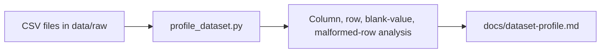
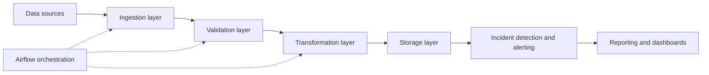

# DataPulse — Data Quality & Pipeline Observability Platform

[](https://github.com/aminah7med/datapulse/actions/workflows/ci.yml)

DataPulse is an extensible data ingestion, quality, and incident management platform designed to provide deep observability into data pipelines. It addresses a critical gap in data engineering: execution success does not guarantee data integrity. A pipeline can run successfully and still deliver stale, incomplete, or unreliable data to downstream systems. DataPulse helps teams detect and respond to data quality issues before they affect business decisions.

## Project Status

### Implemented

- CSV dataset profiling for row counts, column metadata, encoding detection, and blank-value analysis.
- Markdown dataset profile reports that summarize profile findings per CSV file.
- Unit tests covering core CSV profiling logic.
- GitHub Actions CI for linting and testing on pushes and pull requests.
- A Dockerfile for a Python 3.12 environment.

### Planned or In Progress

The following components are defined in the project structure but are not confirmed as operational in the current codebase:

- MySQL storage and schema design
- Airflow orchestration workflows
- Full ETL pipeline orchestration
- Configurable quality rules and validation engine
- Incident tracking and alerting
- Dashboards and reporting views
- Docker Compose application orchestration beyond the local PostgreSQL service

## Key Features

### Current Capabilities

- Profiling CSV files without loading the full dataset into memory
- Detecting malformed CSV rows with inconsistent field counts
- Identifying blank values per column
- Reporting file size, encoding, row totals, and column counts
- Generating a report in `docs/dataset-profile.md`

### Roadmap Focus

- Data ingestion from multiple sources
- Row- and schema-level validation
- Transformation pipelines
- Quality checks and policy enforcement
- Observability and incident management

## Technology Stack

- Python 3.12+
- pytest for automated testing
- Ruff for linting
- Docker for containerized execution
- PostgreSQL as a target backend for future storage
- Apache Airflow as a planned orchestration layer

## Architecture

### Current Implementation: CSV Profiling Flow



### Planned Future Architecture



This future diagram is illustrative and should not be interpreted as a completed operational deployment.

## Repository Structure

```text
datapulse/
├── .github/
│   └── workflows/
│       └── ci.yml                 # CI workflow for lint and tests
├── .env.example                  # Local environment template
├── .gitignore                    # Ignored files and folders
├── Dockerfile                    # Python 3.12 container definition
├── docker-compose.yml            # Local PostgreSQL service definition
├── pyproject.toml                # Packaging and tooling configuration
├── README.md                     # Project overview and usage guide
├── data/
│   └── raw/                      # Source CSV data files
├── database/                     # Planned schema and storage work
├── airflow/                      # Planned Airflow configuration
├── requirements/                 # Optional dependency files and guidance
├── scripts/
│   ├── inspect_review_anomalies.py # Review-row inspection utility
│   └── profile_dataset.py        # CSV profiling CLI
├── src/
│   └── datapulse/
│       ├── config/
│       ├── ingestion/
│       ├── quality/
│       ├── validation/
│       ├── transformation/
│       ├── storage/
│       └── incidents/
├── docs/
│   └── dataset-profile.md        # Generated profiling report
├── tests/
│   ├── README.md                 # Testing guidance
│   ├── unit/
│   │   ├── test_profile_dataset.py
│   │   └── test_project_structure.py
│   └── integration/
│       └── .gitkeep
```

## Dataset and Attribution

This project uses the Olist Brazilian E-Commerce Dataset, which is available from Kaggle:

- Source: https://www.kaggle.com/datasets/olistbr/brazilian-ecommerce

The repository currently focuses on the built-in CSV datasets in `data/raw`, especially the core Olist tables used for profiling and data-quality review. The generated report in [`docs/dataset-profile.md`](docs/dataset-profile.md) summarizes file-level findings from the dataset.

The Olist dataset is commonly referenced as a public, reusable dataset for analytics and research. The dataset source page should be checked for the latest licensing or usage terms. This repository does not publish credentials or local absolute paths.

## Prerequisites and Installation

### Requirements

- Python 3.12+
- pip
- Optional: Docker and Docker Compose for local PostgreSQL services

### Windows PowerShell

```powershell
git clone https://github.com/aminah7med/datapulse.git
cd datapulse
python -m venv .venv
.\.venv\Scripts\Activate.ps1
pip install -e ".[dev]"
```

### macOS/Linux

```bash
git clone https://github.com/aminah7med/datapulse.git
cd datapulse
python3.12 -m venv .venv
source .venv/bin/activate
pip install -e ".[dev]"
```

## Usage

### Run the CSV profiler

```bash
python scripts/profile_dataset.py
```

This command scans all CSV files in `data/raw` and writes a Markdown report to `docs/dataset-profile.md`.

### Custom paths

```bash
python scripts/profile_dataset.py --raw-dir data/raw --output docs/dataset-profile.md
```

### CLI arguments

- `--raw-dir`: directory containing CSV files; default is `data/raw`
- `--output`: output path for the generated Markdown report; default is `docs/dataset-profile.md`

### Generated report

The report includes:

- file size and encoding
- number of rows and columns
- number of blank values per column
- malformed rows with inconsistent field counts
- a per-file summary for each CSV dataset

If the target directory is missing, the script exits with an error before producing output. If profile generation encounters file or CSV parsing problems, the report includes error details for the affected file.

### Inspect the generated profile

```bash
cat docs/dataset-profile.md
```

## Testing and Code Quality

### Run tests

```bash
pytest
```

### Run lint checks

```bash
ruff check .
```

The CI workflow in [`.github/workflows/ci.yml`](.github/workflows/ci.yml) runs the same checks on every push and pull request:

- `python -m pip install -e ".[dev]"`
- `ruff check .`
- `pytest`

These checks validate the current Python configuration and the implemented profiling logic. They do not yet claim to cover the broader ETL, Airflow, or database components that are still planned.

## Dataset Profile Summary

The project includes a generated dataset profile at [`docs/dataset-profile.md`](docs/dataset-profile.md). The latest report shows that the Olist dataset includes high-volume tables such as `olist_geolocation_dataset.csv` and `olist_orders_dataset.csv`, with relatively few malformed rows overall. The report also highlights important data-quality observations such as blank values in order timestamps and review text fields.

These findings are examples from the current generated report and should be refreshed when the dataset or profiling run changes.

## Roadmap

The project is intentionally scoped in phases:

- Schema analysis and EERD generation
- MySQL schema design and relational modeling
- Python ingestion and data validation modules
- Configurable quality rules for completeness, validity, and uniqueness
- Incident tracking and operational alerting
- Airflow DAGs for orchestration
- Docker-based integration testing
- Reporting and dashboards for data quality visibility

These items are future work unless explicitly implemented in the current branch.

## Contributing and Development Workflow

Contributions are welcome through issues and pull requests.

1. Open or review an issue in the GitHub repository.
2. Create a meaningful branch for the change.
3. Make focused, well-documented updates.
4. Add or update tests when relevant.
5. Run the project checks locally.
6. Submit a pull request against `main`.

Recommended local checks:

```bash
pytest
ruff check .
```

See [`tests/README.md`](tests/README.md) for testing guidance and conventions.

## License and Usage Notes

This repository is for project documentation and prototyping. It does not claim a complete production deployment. The Olist dataset used in the profiling examples should be treated according to the source dataset license and usage terms.

---

DataPulse is a foundation for building more trustworthy, observable data pipelines. The current implementation demonstrates the first step: understanding the shape and quality of a dataset before it reaches downstream consumers.
